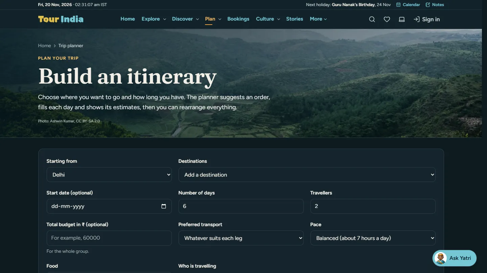
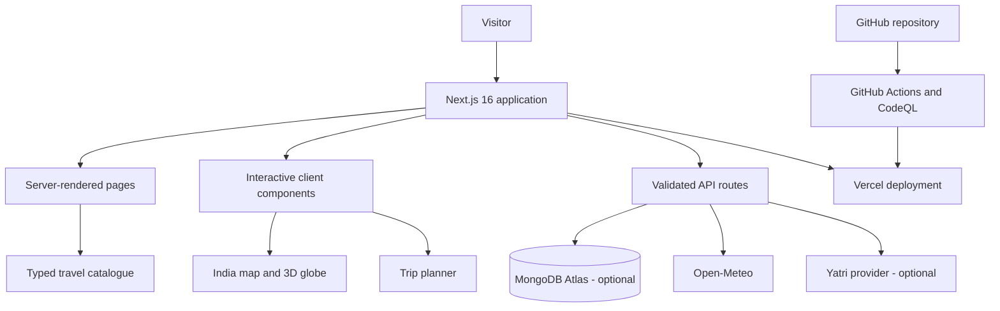

<!-- Tour India · Project README · Current application lives on rebuild/nextjs -->

<div align="center">

<a href="https://tour-india-pi.vercel.app">
  
</a>

<h1>🇮🇳 Tour India</h1>

<p><strong>Discover India. Understand its places. Plan your journey.</strong></p>

<p>
  An independent travel guide to India's <strong>28 states and 8 Union Territories</strong> —
  bringing destinations, culture, practical travel information and itinerary planning into one place.
</p>

<p>
  <a href="https://tour-india-pi.vercel.app"></a>
  <a href="https://github.com/Supriyo016/TourIndia/tree/rebuild/nextjs"></a>
</p>

<p>
  <a href="https://github.com/Supriyo016/TourIndia/actions/workflows/ci.yml"></a>
  <a href="https://github.com/Supriyo016/TourIndia/actions/workflows/codeql.yml"></a>
  
  
  
  
  
</p>

<p>
  
  
  
  
</p>

<sub>Created and maintained by <a href="https://github.com/Supriyo016">Supriyo Sarkar</a> · Founder & Website Owner</sub>

</div>

---

> [!IMPORTANT]
> **Tour India is an independent travel information and planning platform, not a travel agency.** It does not sell tours, issue tickets, confirm hotel reservations, process payments or guarantee third-party availability. The planner's travel times and costs are estimates; visitors must verify important details with official sources and service providers.

## 🧭 Explore India

Tour India brings travel discovery, regional knowledge and practical planning together. Start with a state, find a destination, explore local traditions, compare places and turn selected destinations into an editable itinerary.

<div align="center">
  <a href="https://tour-india-pi.vercel.app">
    
  </a>
  <sub>Tour India · Homepage experience</sub>
</div>

## 📊 The content at a glance

The current editorial catalogue includes:

| Coverage | Published content |
|---|---:|
| Indian states and Union Territories | **36 profiles** |
| Destination guides | **52 guides** |
| UNESCO World Heritage Sites | **45 entries** |
| Festivals | **24 entries** |
| Regional dishes | **29 entries** |
| Traditional art forms | **64 entries** |
| Ready-made travel circuits | **6 circuits** |

These are catalogue counts, not claims about all attractions, festivals or cultural traditions in India. See the content modules in `src/data/` for the current records.

## ✨ What you can do

### 1. Discover destinations

- Explore an interactive map of India's states and Union Territories.
- Open state profiles with capital, regional identity, languages, food, festivals and destination links.
- Browse destination guides with recommended months, suggested stay length, attractions, travel access, accommodation areas, cost ranges and practical notes.
- Search and filter destinations by region, category, season and trip length.
- Compare destinations before choosing where to go.
- Find lesser-known places alongside popular destinations.

### 2. Explore India in 3D

- Rotate an interactive globe containing destination guide locations.
- Select a marker to open the corresponding destination.
- Use the state map to move from national overview to state-level information.
- Explore destination photography and themed travel stories.

<div align="center">
  <table>
    <tr>
      <td width="50%">
        
        <p align="center"><strong>Explore the globe</strong><br /><sub>Navigate destination locations visually</sub></p>
      </td>
      <td width="50%">
        
        <p align="center"><strong>Destination guides</strong><br /><sub>Season, suggested stay and practical information</sub></p>
      </td>
    </tr>
  </table>
</div>

### 3. Build a trip plan

The trip planner turns selected destinations into an editable day-by-day outline.

- Choose a starting city and one or more destinations.
- Set trip duration, traveller count, travel pace and interests.
- Select a preferred transport mode or let the planner choose a suitable mix.
- Review suggested attractions and daily allocations.
- See estimated travel legs, journey duration and costs.
- Rearrange the itinerary and review warnings when the trip looks too rushed.
- Share a plan or reopen it in the planner.

<div align="center">
  
  <br /><sub>Trip planner · Editable day-by-day plan</sub>
</div>

> [!NOTE]
> Itinerary distances, travel durations and prices are planning estimates generated from the site's assumptions. They are not live fares, live traffic, a transport timetable or a booking quote.

### 4. Explore culture and heritage

- Browse festivals, observances and public holidays in a calendar.
- Check how festival dates are determined and whether a date is confirmed.
- Export calendar entries in `.ics` format.
- Discover regional cuisine and traditional dishes.
- Explore art forms, crafts, dance, music and living traditions.
- Browse UNESCO heritage information, museums and cultural places.
- Read travel stories and practical explainers.

### 5. Ask Yatri

**Yatri** is Tour India's travel assistant. It can help visitors find destination information, explore states, look up festivals and food, compare possible travel options and draft a trip plan from the website's own content.

- Uses Tour India's own travel catalogue as its knowledge source.
- Can answer from the guides without an external AI provider.
- Can use a configured server-side provider (Groq or Vercel AI Gateway).
- Links answers to relevant Tour India pages.
- Applies bounded tool calls, response limits and request limits.

The assistant is an information aid, not an official authority. It cannot confirm permits, closures, medical advice, safety conditions or live booking availability. Recheck those with the relevant authority.

### 6. Save and share your travel ideas

Depending on service configuration, the platform includes:

- User accounts and profile settings.
- Saved places, trips, notes, collections and travel memories.
- Shareable trip and itinerary links.
- Personal notifications and privacy controls.
- Account deletion and session management.
- Community stories, comments, questions, tips and suggested edits with moderation.

### 7. Administration and content operations

The application also contains an owner/admin area for platform operations:

- Content editing, review queues and scheduled publishing.
- Community moderation and support tickets.
- User, role and permission management.
- Security and audit logs.
- Health, error and Web Vitals views.
- SEO tools, backups and feature settings.

Administrative screens are protected and are not public content-authoring endpoints.

## 🖼️ More of the experience

<div align="center">
  
  <br /><sub>Responsive destination page · Mobile layout</sub>
</div>

The application also includes culture pages, a photo/video gallery, travel stories, a calendar, comparisons, a quiz, practical services and account areas. The public route inventory is available under `src/app/`.

## 🧰 Technology stack

<div align="center">
  
</div>

| Layer | Technology |
|---|---|
| Framework | Next.js 16 · App Router |
| UI | React 19 · Server Components and interactive client components |
| Language | TypeScript · strict mode |
| Styling | Tailwind CSS 4 · custom design tokens |
| Database | MongoDB 7 driver · MongoDB Atlas when configured |
| Validation and forms | Zod · React Hook Form |
| Maps | SVG India map · 3D globe · Google Maps integrations when configured |
| Drag-and-drop | dnd kit |
| AI assistant | Yatri · Groq or Vercel AI Gateway (optional) |
| Forecasts | Open-Meteo |
| Testing | Vitest · Playwright · axe |
| Code quality | ESLint · TypeScript · npm audit |
| Security analysis | GitHub CodeQL |
| Dependency updates | Dependabot |
| Hosting | Vercel |
| CI/CD | GitHub Actions |

## 🏗️ Architecture

Tour India uses a Next.js App Router architecture. Pages are rendered on the server wherever practical; client-side code is reserved for interactive experiences such as the map, planner, search, forms and globe.



### Architectural principles

- **Content-first:** states, destinations, food, festivals and other editorial material are typed modules.
- **Server by default:** interactive code is kept to smaller client-side features.
- **Optional persistence:** the public guides can be explored without connecting MongoDB; features that save data need a configured database.
- **Validate at boundaries:** API requests are checked for origin, content type, body size, rate limits and schema validity.
- **Keep secrets server-side:** provider keys and database credentials belong in deployment environment variables.
- **Progressive fallbacks:** the guide remains useful when optional integrations are not configured.

More detail: [Architecture](docs/architecture.md).

## 📁 Repository structure

The current application is organised by route, UI component and feature logic.

```text
TourIndia/
├── .github/
│   ├── ISSUE_TEMPLATE/
│   ├── workflows/
│   │   ├── ci.yml
│   │   └── codeql.yml
│   └── dependabot.yml
├── docs/
│   ├── assets/              # README banner and screenshots
│   ├── research/
│   ├── architecture.md
│   ├── setup.md
│   ├── api.md
│   ├── FACT_CHECK.md
│   ├── PROJECT_STATUS.md
│   ├── OPERATIONS.md
│   └── SECURITY_AUDIT.md
├── legacy/                  # Original 2022 static website
├── public/
│   └── images/              # Optimised destination, state and culture media
├── scripts/                 # Map, image and database utilities
├── src/
│   ├── app/                 # Routes, layouts and API endpoints
│   ├── components/          # Shared UI and feature components
│   ├── config/              # Site, brand and navigation configuration
│   ├── data/                # Typed editorial content
│   ├── features/             # Planner, assistant, accounts, community, etc.
│   ├── hooks/                # Shared React hooks
│   ├── lib/                  # Database, security, validation and utilities
│   ├── proxy.ts
│   └── types/
├── tests/
│   ├── e2e/
│   ├── security/
│   ├── unit/
│   └── support/
├── .env.example
├── package.json
└── README.md
```

Generated data under `src/data/generated/` is produced by scripts. Avoid hand-editing generated files; update their source and run the relevant generator instead.

## 🚀 Getting started

### Prerequisites

- Node.js **20.9 or later**
- npm
- Git

### 1. Clone the current application branch

The current Next.js application is maintained on **`rebuild/nextjs`**.

```bash
git clone --branch rebuild/nextjs https://github.com/Supriyo016/TourIndia.git
cd TourIndia
```

### 2. Install dependencies

```bash
npm install
```

### 3. Configure local environment

```bash
cp .env.example .env.local
```

On Windows PowerShell:

```powershell
Copy-Item .env.example .env.local
```

### 4. Start the development server

```bash
npm run dev
```

Open **[http://localhost:3000](http://localhost:3000)**.

The guide and destination content can be explored without a database. Save/submit features such as forms, accounts and community contributions need their corresponding services to be configured.

## ⚙️ Environment configuration

The complete, commented reference is [`.env.example`](.env.example). Keep real secrets in `.env.local` locally and in Vercel project settings for deployment. Never commit secret values.

| Variable | Purpose | Needed for |
|---|---|---|
| `NEXT_PUBLIC_SITE_URL` | Canonical public origin and same-origin checks | Production URL configuration |
| `MONGODB_URI` | MongoDB connection string | Persistence, accounts and saving/submission features |
| `MONGODB_DB` | Database name (default `tour_india`) | MongoDB |
| `RATE_LIMIT_SALT` | Salt for privacy-conscious rate-limit identifiers | Production rate limiting with database |
| `GROQ_API_KEY` | Server-side Yatri provider | Optional AI responses |
| `AI_GATEWAY_API_KEY` | Vercel AI Gateway key | Alternative optional Yatri provider |
| `AI_GATEWAY_OIDC` | Use deployment OIDC for AI Gateway | Alternative Vercel deployment setup |
| `ASSISTANT_MODELS` | Ordered model list override | Optional Yatri configuration |
| `ASSISTANT_DAILY_LIMIT` | Daily Yatri response ceiling | Optional Yatri configuration |
| `COOKIE_SECRET` | Session-cookie signing secret | Optional explicit cookie secret |
| `AUTH_SECRET` | Authentication and sign-in flow secret | Accounts |
| `RESEND_API_KEY` | Email delivery | Email sign-in codes |
| `EMAIL_FROM` | Verified sender identity | Email delivery |
| `AUTH_GOOGLE_ID`, `AUTH_GOOGLE_SECRET` | Google OAuth client | Optional Google sign-in |
| `ADMIN_EMAILS` | Addresses allowed to sign in as administrators | Admin access |
| `GOOGLE_SITE_VERIFICATION` | Search Console verification token | Optional SEO verification |
| `NEXT_PUBLIC_GOOGLE_MAPS_API_KEY` | Google Maps browser API key | Optional Google Maps features |
| `NEXT_PUBLIC_GOOGLE_MAP_ID` | Vector Map ID with required feature layer | Optional state map styling |
| `TRUSTED_PROXY_HOPS` | Trusted reverse-proxy count | Self-hosted proxy deployments |

### Optional services at a glance

| Capability | Without configuration | With configuration |
|---|---|---|
| Destination and state guides | Available | Available |
| Search and itinerary planning | Available | Available |
| Yatri | Answers from Tour India's own guide data | Can use Groq or Vercel AI Gateway |
| MongoDB-backed forms and saved data | Submission/persistence features report unavailable | Store data in configured MongoDB |
| Email sign-in | Not available | Requires Resend and sender setup |
| Google sign-in | Not available | Requires OAuth client credentials |
| Google Maps enhancements | Drawn map / keyless map fallback as supported | Configured map features |
| Admin area | Not usable without access setup | Requires database, auth and admin configuration |

For complete instructions, including database initialisation, OAuth callback setup, maps, AI-provider configuration and deployment, see [Setup and deployment](docs/setup.md).

## 🧪 Development and quality checks

Run the checks before submitting changes:

```bash
npm run typecheck
npm run lint
npm test
npm run build
```

Run browser and accessibility tests:

```bash
npx playwright install --with-deps chrome
npm run test:e2e
```

### Available npm scripts

| Command | Purpose |
|---|---|
| `npm run dev` | Start Next.js in development mode |
| `npm run build` | Build the production application |
| `npm run vercel-build` | Run deployment database setup and build |
| `npm run start` | Serve the production build |
| `npm run lint` | Run ESLint |
| `npm run typecheck` | Generate Next.js types and run TypeScript |
| `npm test` | Run Vitest unit and API tests |
| `npm run test:e2e` | Run Playwright browser tests |
| `npm run db:setup` | Prepare database collections, validators and indexes |
| `npm run data:map` | Rebuild generated India map data |
| `npm run data:images` | Rebuild/fetch the image manifest |

### Continuous integration

The GitHub Actions workflow checks:

1. Install dependencies with `npm ci`.
2. Audit production dependencies.
3. Generate types and run TypeScript checks.
4. Run ESLint.
5. Run unit, API and security tests against a MongoDB service.
6. Build the production application.
7. Install Chrome and run Playwright end-to-end tests.

A separate CodeQL workflow analyses the JavaScript/TypeScript code. Dependabot checks for dependency updates.

> A workflow badge reports the status GitHub currently returns for that branch; it should not be interpreted as a permanent guarantee that every environment-specific integration is configured.

## ☁️ Deployment

The current Next.js application is intended to deploy through **Vercel**. The deployment build uses `npm run vercel-build`, which runs the database setup step and then builds Next.js.

**Important branch distinction**

- `rebuild/nextjs` — current Next.js application source.
- `master` — legacy/original site branch in the repository's current project history.

Before connecting or changing a Vercel project, verify its production branch. Pointing a project at the legacy branch can deploy the old static site instead of this application.

For step-by-step deployment, production environment variables, database setup, release checks and rollback, read [docs/setup.md](docs/setup.md) and [docs/OPERATIONS.md](docs/OPERATIONS.md).

## 🔐 Security, privacy and responsible travel

Tour India uses server-side validation and operational safeguards, but no application should claim to be completely secure.

- API writes check request origin, JSON content type, payload size, schema and rate limits.
- Database access is server-side; secrets are not intended for public client bundles.
- Authentication uses signed session state and optional email/Google sign-in configuration.
- Admin areas use account and role controls.
- Personal records and shared content have separate access rules.
- Consent controls govern optional storage and analytics behaviour.
- Security tests and CodeQL are included in the repository workflows.

Read [Security Audit](docs/SECURITY_AUDIT.md), [Operations](docs/OPERATIONS.md) and [Backups](docs/BACKUPS.md) for the actual controls, known limits and operating responsibilities.

### Travel information has limits

Travel rules change. Always verify the following before acting:

- Entry permits and protected-area requirements.
- Weather, seasonal closures and road conditions.
- Religious-site entry rules and local customs.
- Safety advisories and emergency contacts.
- Transport schedules, fares and hotel availability.

The state map is a navigation visual and is **not an authoritative depiction of India's external boundaries**. Consult official government sources for authoritative maps and legal boundaries.

Tour India does not accept responsibility for decisions made solely from an itinerary estimate or an unverified guide entry. Source and review notes are maintained in [docs/FACT_CHECK.md](docs/FACT_CHECK.md).

## 📚 Documentation

| Document | What it covers |
|---|---|
| [Project status](docs/PROJECT_STATUS.md) | Current state, verified work, known limitations and owner actions |
| [Setup and deployment](docs/setup.md) | Local setup, environment, MongoDB, Vercel and rollback |
| [Architecture](docs/architecture.md) | Rendering model, code layout and data flow |
| [API reference](docs/api.md) | API routes, inputs and persistence |
| [Operations](docs/OPERATIONS.md) | Daily operational tasks and troubleshooting |
| [Backups](docs/BACKUPS.md) | Data backup and recovery |
| [Security audit](docs/SECURITY_AUDIT.md) | Implemented controls, test coverage and residual risks |
| [Fact checking](docs/FACT_CHECK.md) | Travel-content sources and verification notes |
| [Decisions](docs/DECISIONS.md) | Important engineering and product decisions |
| [Contributing](CONTRIBUTING.md) | Contribution rules and pull-request workflow |

## 🤝 Contributing

Corrections to travel facts, source links, accessibility improvements and bug reports are valuable contributions.

1. Read [CONTRIBUTING.md](CONTRIBUTING.md).
2. Open an issue using the relevant template for bugs or content corrections.
3. Create a focused branch from the current application branch.
4. Include sources for travel-related factual changes.
5. Run lint, typecheck, unit tests, production build and browser tests.
6. Open a pull request with a clear explanation of the changes and checks.

Please do not add unsupported prices, availability, visitor counts, safety assurances or booking claims. Photos must have a reusable licence and a corresponding credit.

Security issues should be reported privately using the instructions in [SECURITY.md](SECURITY.md).

## 🧾 Licence and media credits

The application code is released under the [MIT Licence](LICENSE). Photographs, map data, videos, and other media may carry separate licences and attribution requirements; the code licence does not automatically apply to those materials.

- Photographic credits are listed on the relevant pages and on [/credits](https://tour-india-pi.vercel.app/credits).
- Weather forecasts are supplied by [Open-Meteo](https://open-meteo.com/).
- Map and geographic data have their own provider and licence conditions; consult the project's credits and fact-check documentation.
- The original static website is preserved in [`legacy/`](legacy/).

## 📬 Project owner

<div align="center">


<a href="https://github.com/Supriyo016"></a>
<a href="https://x.com/Supriyo016"></a>
<a href="https://www.instagram.com/supriyo016/"></a>
<a href="https://www.youtube.com/@supriyo016"></a>
<a href="https://www.facebook.com/profile.php?id=100070487584093"></a>

**Explore more. Travel thoughtfully. Respect every place and community.**

<a href="https://tour-india-pi.vercel.app">Open Tour India ↗</a>

</div>

---

<div align="center">
  <sub>Tour India · An independent guide to discovering and planning travel across India.</sub>
  <br />
  <sub>Built and maintained by <a href="https://github.com/Supriyo016">Supriyo Sarkar</a>.</sub>
  <br /><br />
  <a href="https://tour-india-pi.vercel.app"></a>
</div>
