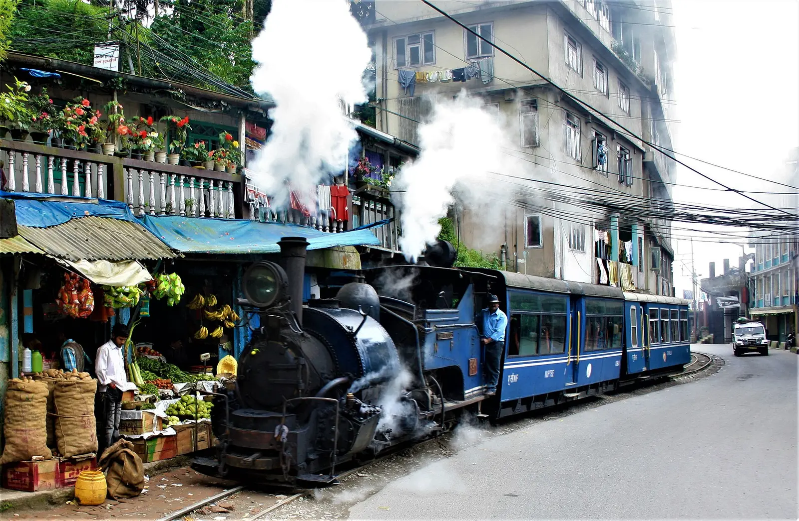
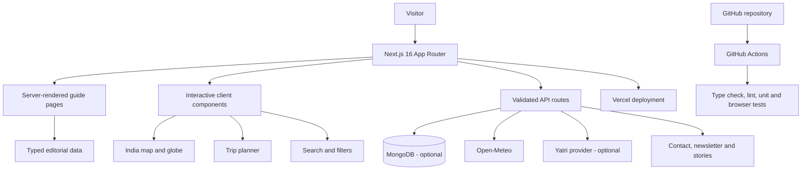

<!-- Tour India | Travel discovery and itinerary planning platform -->

<div align="center">

<a href="https://tour-india-pi.vercel.app">

</a>

# 🇮🇳 Tour India

### Discover India. Explore its culture. Plan your own journey.

**An independent travel discovery and planning platform for India's states, destinations, heritage and living culture.**

<p>
<a href="https://tour-india-pi.vercel.app"></a>
<a href="https://github.com/Supriyo016/TourIndia/tree/rebuild/nextjs"></a>
<a href="https://github.com/Supriyo016/TourIndia"></a>
</p>

<p>
<a href="https://github.com/Supriyo016/TourIndia/actions/workflows/ci.yml"></a>
<a href="https://img.shields.io/badge/Next.js-16-000?logo=nextdotjs"></a>
<a href="https://img.shields.io/badge/React-19-149ECA?logo=react"></a>


</p>

<sub>Created and maintained by <a href="https://github.com/Supriyo016"><strong>Supriyo Sarkar</strong></a> · Founder & Website Owner</sub>

</div>

---

> [!IMPORTANT]
> **What Tour India is — and is not:** Tour India is an independent travel information and itinerary-planning platform, not a travel agency or booking operator. It does not sell tours, issue tickets, confirm hotel reservations, process payments, or guarantee third-party availability. Route distances, travel times and budget values in planner outputs are estimates. Always confirm current conditions, permits, fares, opening hours and safety information with the relevant official authority or service provider.

## 🧭 Quick navigation

| Section | Description |
|---|---|
| [About the platform](#-about-the-platform) | What Tour India offers |
| [Explore India](#-explore-india) | State map, globe and destinations |
| [Culture and heritage](#-culture-food-and-heritage) | Festivals, regional food, arts and heritage |
| [Trip planner](#-trip-planner) | Editable itinerary workflow |
| [Yatri assistant](#-yatri-travel-assistant) | Search and travel guidance |
| [Screens and experience](#-visual-showcase) | Current visual assets and responsive design |
| [Technology and architecture](#-technology-stack) | Framework, data and system design |
| [Run locally](#-run-locally) | Development setup |
| [Environment and services](#-environment-configuration) | Optional integrations |
| [Testing and deployment](#-quality-assurance-and-deployment) | Checks and release workflow |
| [Security and content standards](#-security-privacy-and-travel-information) | Responsible data and travel content |
| [Documentation](#-project-documentation) | Engineering references |

## 🏞️ About the platform

Tour India brings destination discovery, cultural information and itinerary planning into one place. Visitors can explore an Indian state, browse destination guides, understand local traditions, compare travel ideas and build a personal trip outline.

The current Next.js application is maintained on **`rebuild/nextjs`**. The repository's `master` branch is the legacy/original site in the current branch history. This README documents the Next.js application branch.

### Platform at a glance

<div align="center">
<table>
<tr>
<td align="center" width="25%"><h2>28 + 8</h2><strong>States & UTs</strong><br><sub>Regional profiles</sub></td>
<td align="center" width="25%"><h2>52</h2><strong>Destinations</strong><br><sub>Structured travel guides</sub></td>
<td align="center" width="25%"><h2>45</h2><strong>Heritage entries</strong><br><sub>UNESCO-listed properties</sub></td>
<td align="center" width="25%"><h2>24</h2><strong>Festivals</strong><br><sub>Editorial calendar entries</sub></td>
</tr>
<tr>
<td align="center" colspan="2"><h2>29</h2><strong>Regional food entries</strong></td>
<td align="center" colspan="2"><h2>64</h2><strong>Traditional arts and cultural forms</strong></td>
</tr>
</table>
<sub>Counts are derived from the structured content collections in this source branch. They describe the current catalogue, not complete coverage of every place or tradition in India.</sub>
</div>

## ✨ Explore India

### 🗺️ Interactive state map

Explore India's 28 states and 8 Union Territories through an interactive map experience.

- Select a region or state to open its profile.
- Explore state-level destinations, culture, food and festival information.
- Move from a state overview into its related destination guides.
- Map geometry and content are part of the project's editorial/navigation experience; consult the map credits and site notes for scope and limitations.

### 🌐 Destination globe

A 3D globe provides another way to explore the destination catalogue.

- Rotate and inspect the globe.
- Select destination markers to open corresponding guides.
- Discover locations spatially before reading the detailed destination pages.

### 📍 Destination guides

Destination pages connect editorial travel information with practical planning context, including:

- Overview, location and destination highlights.
- Attractions and nearby places.
- Recommended travel period and suggested stay.
- Ways to reach the destination and local transport notes.
- Accommodation areas, regional food and experiences.
- Permit notes, accessibility information and practical precautions.
- Estimated budget ranges and useful external references.

### Travel catalogue

| Content collection | Current entries |
|---|---:|
| State and Union Territory profiles | **36** |
| Destination guides | **52** |
| UNESCO World Heritage entries | **45** |
| Festival entries | **24** |
| Regional dishes | **29** |
| Traditional art forms | **64** |
| Travel circuits | **6** |

## 🎭 Culture, food and heritage

Tour India treats culture as more than a list of tourist attractions. The catalogue includes living traditions, festivals, food and heritage references.

### Festival calendar

- Browse festival entries and date information.
- Filter the calendar and review source notes.
- Export supported calendar entries.
- Check the stated date and source because festival dates can vary by regional calendar and announcement.

### Regional food

Explore regional dishes and food traditions across states and destination pages.

### Arts and traditions

Browse traditional art forms, crafts, dance and music, with regional context and supporting information.

### Heritage and museums

Explore heritage entries and museums, with references to the relevant source material. UNESCO status and inscription details should always be read in the context of the official World Heritage List.

## 🧳 Trip planner

The trip planner helps users build and edit a multi-stop outline using selected destinations and their travel preferences.

- Set a starting point and choose destinations.
- Configure trip duration, travellers, budget, pace and interests.
- Review day-wise destination allocation and activity suggestions.
- Inspect approximate distances, travel legs, time and cost.
- Rearrange the itinerary and review warnings about overly rushed schedules.
- Use supported share/export options to retain or share a plan.

> [!NOTE]
> Planner calculations are estimates based on declared assumptions and available route information. They are not live ticket fares, confirmed transport schedules, accommodation quotes or booking confirmations. Validate every important leg independently before travelling.

## 🤖 Yatri — travel assistant

Yatri is the travel assistant integrated with the Tour India content and tools.

- Search the site's destination and state catalogue.
- Ask about destinations, festivals, regional food and practical travel topics.
- Discover relevant Tour India guides.
- Generate draft itinerary suggestions using the site's travel data.
- Use the built-in guide-answer path without an external AI provider.
- Optionally use a server-configured Groq or Vercel AI Gateway provider.

Yatri is not an official government source. It cannot guarantee current permits, closures, weather warnings, transport availability, personal safety or booking status. Verify consequential information directly with authoritative sources.

## 👤 Accounts, personal travel and community

When the required backend and authentication settings are configured, the application includes account and personal travel workflows such as saved places, trips, notes, memories, collections, profile preferences, notifications, privacy controls and account deletion.

The codebase also contains community and editorial workflows for stories, discussions, tips, questions, suggestions, moderation and review. Public persistence and account-dependent behaviour require the relevant backend services to be configured; their presence in the source code does not mean every feature is enabled on every deployment.

## 🛡️ Administration and operations

The application includes protected administration routes and operational tooling for supported content, moderation, support, permissions, audit activity, system health, SEO, backups and scheduled publishing. Administrative pages are access-controlled and are not public travel-guide features.

## 🖼️ Visual showcase

The repository stores the animated brand banner and destination/state/culture image assets in the current application branch.

<div align="center">

<a href="https://tour-india-pi.vercel.app">

</a>
<a href="https://tour-india-pi.vercel.app">

</a>
<br>
<sub>Destination catalogue · Examples from the locally maintained image collection</sub>

<br><br>

<a href="https://tour-india-pi.vercel.app">

</a>
<a href="https://tour-india-pi.vercel.app">

</a>
<br>
<sub>State profiles · Regional discovery</sub>

<br><br>

<a href="https://tour-india-pi.vercel.app">

</a>
<a href="https://tour-india-pi.vercel.app">

</a>
<a href="https://tour-india-pi.vercel.app">

</a>
<br>
<sub>Culture · Food · Traditional arts</sub>

</div>

## 📱 Responsive experience

The platform is built for desktop and mobile browsing. The interface combines destination photography, map-based discovery, content-led guide pages and interactive planner controls.

The current source includes responsive page components and browser-based end-to-end tests. Visual media in this README links to repository assets; the deployed site remains the best place to inspect the complete interactive experience.

## 🧰 Technology stack

<div align="center">

</div>

| Layer | Technology |
|---|---|
| Framework | Next.js 16 App Router |
| UI | React 19 |
| Language | TypeScript strict mode |
| Styling | Tailwind CSS 4 |
| Database | MongoDB driver / MongoDB Atlas when configured |
| Validation | Zod |
| Forms | React Hook Form |
| Interactions | dnd kit |
| Maps and geography | SVG map, 3D globe and optional Google Maps integration |
| Weather | Open-Meteo |
| Travel assistant | Yatri · Groq or Vercel AI Gateway (optional) |
| Unit testing | Vitest |
| Browser testing | Playwright |
| Accessibility checks | axe-core / Playwright |
| Code quality | ESLint · TypeScript |
| Security checks | npm audit · GitHub Actions |
| Static analysis | CodeQL (where workflow is configured) |
| Hosting | Vercel |
| CI | GitHub Actions |

## 🏗️ Architecture

The current application uses Next.js App Router. Most pages are rendered as server components from typed editorial content. Client-side code is reserved for interactive areas such as the navigation, search, hero, maps, filters, trip planner and forms. Server API routes validate incoming requests before accessing external services or persistent storage.



### Architecture principles

- **Content-first structure:** typed editorial data drives state, destination and culture pages.
- **Server-first rendering:** page content is rendered on the server; client components are used where interaction is required.
- **Optional persistence:** the public guide works without a database; persistent submissions and account workflows need MongoDB and relevant configuration.
- **Validated API boundaries:** same-origin checks, content-type checks, request-size limits, rate limits and Zod validation are applied where relevant.
- **Server-side secrets:** API credentials and database connections belong in server-only environment variables.
- **Fallback paths:** optional service integrations should not be confused with essential guide content.

Read [docs/architecture.md](docs/architecture.md) for the implementation map.

## 📂 Repository structure

```text
TourIndia/
├── .github/
│   └── workflows/             # CI workflows
├── docs/
│   ├── research/              # Research notes
│   ├── architecture.md        # Application architecture
│   ├── setup.md               # Local setup and deployment
│   ├── api.md                 # API reference
│   ├── PROJECT_STATUS.md      # Project state and owner notes
│   ├── OPERATIONS.md          # Operations guide
│   ├── SECURITY_AUDIT.md      # Security review notes
│   └── FACT_CHECK.md          # Travel content fact-check log
├── legacy/                    # Original static website
├── public/
│   └── images/                # Brand, destination and culture assets
├── scripts/                   # Data builders and database setup
├── src/
│   ├── app/                   # App Router pages and API routes
│   ├── components/            # Reusable interface components
│   ├── config/                # Site and brand settings
│   ├── data/                  # Typed destination and culture content
│   ├── features/              # Planner, assistant and domain logic
│   ├── hooks/                 # Reusable client hooks
│   ├── lib/                   # Database, validation and helpers
│   └── types/                 # TypeScript content types
├── tests/
│   ├── e2e/                   # Browser tests
│   ├── security/               # Security and route tests
│   └── unit/                   # Unit tests
├── .env.example
├── package.json
└── README.md
```

Generated data under `src/data/generated/` is built by project scripts. Update its source records and regenerate the output rather than editing generated files manually.

## 🚀 Run locally

### Requirements

- Node.js **20.9 or later**
- npm
- Git

### Clone the current application branch

The current Next.js application lives on **`rebuild/nextjs`**. Do not assume that `master` contains this application; it is the legacy branch in the current repository history.

```bash
git clone --branch rebuild/nextjs https://github.com/Supriyo016/TourIndia.git
cd TourIndia
npm install
```

Create a local environment file:

```bash
cp .env.example .env.local
```

On Windows PowerShell:

```powershell
Copy-Item .env.example .env.local
```

Start the development server:

```bash
npm run dev
```

Open [http://localhost:3000](http://localhost:3000).

The public guide can run without a database. Features that persist submissions, user data or account activity require the relevant backend configuration.

## 🔧 Environment configuration

The full commented variable template is [`.env.example`](.env.example). Keep real credentials out of source control.

| Variable | Purpose |
|---|---|
| `NEXT_PUBLIC_SITE_URL` | Canonical site origin and same-origin form checks |
| `MONGODB_URI` | MongoDB connection string |
| `MONGODB_DB` | Database name (template default: `tour_india`) |
| `RATE_LIMIT_SALT` | Random secret used for rate-limit identifiers |
| `GROQ_API_KEY` | Optional Yatri Groq provider |
| `AI_GATEWAY_API_KEY` / `AI_GATEWAY_OIDC` | Optional Vercel AI Gateway |
| `AUTH_SECRET` | Authentication code and session-related signing |
| `RESEND_API_KEY`, `EMAIL_FROM` | Email code delivery |
| `AUTH_GOOGLE_ID`, `AUTH_GOOGLE_SECRET` | Google OAuth |
| `ADMIN_EMAILS` | Admin sign-in allowlist |
| `NEXT_PUBLIC_GOOGLE_MAPS_API_KEY`, `NEXT_PUBLIC_GOOGLE_MAP_ID` | Optional Google Maps integration |
| `GOOGLE_SITE_VERIFICATION` | Search Console verification |

Some optional settings are commented in the template and may be enabled for advanced deployment scenarios. Read the comments in `.env.example` and [docs/setup.md](docs/setup.md) before enabling them.

### Feature availability

| Capability | Without optional services | With configuration |
|---|---|---|
| State and destination guide pages | Available | Available |
| Editorial culture catalogue | Available | Available |
| Search and trip-planning interface | Available | Available |
| Yatri guide-grounded answers | Available | Available |
| Yatri external AI provider | Not enabled | Groq / Vercel AI Gateway |
| Persistent submissions and saved records | Not available | MongoDB |
| Account and email workflows | Not available | Auth, database and email provider |
| Google sign-in | Not available | OAuth credentials |
| Google Maps enhancements | Fallback experience | Maps configuration |

Detailed service setup and deployment guidance: [docs/setup.md](docs/setup.md).

## 🧪 Quality assurance

Run these checks before submitting a change:

```bash
npm run typecheck
npm run lint
npm test
npm run build
npm run test:e2e
```

Browser tests require the configured Playwright browser. Install it with:

```bash
npx playwright install --with-deps chrome
```

### Useful npm commands

| Command | Purpose |
|---|---|
| `npm run dev` | Start local development |
| `npm run build` | Build the Next.js application |
| `npm run vercel-build` | Run deployment database setup, then build |
| `npm run start` | Start the production server |
| `npm run typecheck` | Generate Next.js types and check TypeScript |
| `npm run lint` | Run ESLint |
| `npm test` | Run Vitest unit tests |
| `npm run test:e2e` | Run Playwright browser tests |
| `npm run db:setup` | Prepare database collections and indexes |
| `npm run data:map` | Regenerate map data |
| `npm run data:images` | Rebuild the image manifest |

### GitHub Actions

The CI workflow in `.github/workflows/ci.yml` sets up Node.js, starts a MongoDB service, installs dependencies, audits production dependencies, runs type checking and lint, executes tests, builds the application and runs browser tests.

## ☁️ Deployment

The production site is:

**[https://tour-india-pi.vercel.app](https://tour-india-pi.vercel.app)**

The current application source is `rebuild/nextjs`. Check the Vercel project's configured production branch before changing deployment settings. A branch mismatch can deploy the legacy site instead of the current Next.js application.

The deployment build uses:

```bash
npm run vercel-build
```

This invokes the deployment database setup script followed by the Next.js production build. MongoDB and other optional service credentials should be configured in the hosting platform's environment settings, never committed to Git.

See:
- [Setup and deployment guide](docs/setup.md)
- [Operations guide](docs/OPERATIONS.md)
- [Project status](docs/PROJECT_STATUS.md)

## 🔐 Security, privacy and travel information

The codebase includes request validation, origin checks, payload-size limits, rate limiting, session and role-related controls for configured account workflows, protected server-side secrets and security-focused tests.

These protections reduce risk; they do not mean that any application is completely secure. Review [docs/SECURITY_AUDIT.md](docs/SECURITY_AUDIT.md) for recorded controls, scope and residual risks.

### Responsible travel information

- Travel permits, border restrictions, opening periods and local rules can change.
- Festival dates and observances may vary by region and official announcement.
- Weather, road access, transport services, fares and accommodation availability require current confirmation.
- Planner times, distances and budgets are estimates, not guaranteed quotations.
- The interactive map is for travel discovery and must not be treated as an authoritative legal boundary map.
- Verify safety-sensitive and permit-related information with the named official authority.

The project's sourcing and review notes are available in [docs/FACT_CHECK.md](docs/FACT_CHECK.md).

## 📚 Project documentation

| Document | Coverage |
|---|---|
| [Architecture](docs/architecture.md) | Rendering model, code layout and data flow |
| [Setup and deployment](docs/setup.md) | Local environment, integrations and hosting |
| [API reference](docs/api.md) | API routes, request validation and responses |
| [Project status](docs/PROJECT_STATUS.md) | Current project status and owner actions |
| [Operations](docs/OPERATIONS.md) | Production operation and maintenance |
| [Security audit](docs/SECURITY_AUDIT.md) | Implemented controls and remaining risks |
| [Fact-check log](docs/FACT_CHECK.md) | Travel-content source and verification notes |

## 🤝 Contributing

Corrections, factual sources, accessibility improvements and reproducible bug reports are welcome.

1. Start from the current `rebuild/nextjs` branch.
2. Make a focused change on a separate branch.
3. Include source references for factual travel-content changes.
4. Run typecheck, lint, unit tests and production build.
5. Add or update tests for behaviour changes.
6. Explain what changed and how it was verified.

Do not invent travel costs, schedules, permits, visitor statistics, safety guarantees or booking availability. Ensure that photographs and other media have appropriate reuse permissions and credits.

## 🧩 More projects by the developer

Tour India is part of a wider collection of academic and engineering projects.

| Project | Focus | Explore |
|---|---|---|
| **DeveloperBro. Academic Portfolio** | Academic profile, research case studies and technical writing | [Live portfolio](https://developerbro.vercel.app) · [GitHub repository](https://github.com/Supriyo016/DeveloperBro-Academic-Portfolio) |
| **Third Hand-Eye** | Arduino Uno, ultrasonic sensing and an audible obstacle-alert prototype | [GitHub repository](https://github.com/Supriyo016/Arduino-Uno-Third-Hand-Eye-Project-for-Visually-Impaired-Individuals) |

<div align="center">
<a href="https://developerbro.vercel.app"></a>
<a href="https://github.com/Supriyo016/Arduino-Uno-Third-Hand-Eye-Project-for-Visually-Impaired-Individuals"></a>
</div>

## 📜 Licence and attribution

Review the repository's current licence and attribution files before reusing code, photographs, videos, map data or third-party media. The presence of an asset in this repository does not automatically grant separate rights to every underlying source.

Useful credits and source notes are linked from the live site's [Credits page](https://tour-india-pi.vercel.app/credits), and from the project fact-check documentation.

## 🧑‍💻 Project owner

<div align="center">

<a href="https://github.com/Supriyo016"></a>

<br>

<a href="https://github.com/Supriyo016"></a>
<a href="https://x.com/Supriyo016"></a>
<a href="https://www.instagram.com/supriyo016/"></a>
<a href="https://www.youtube.com/@supriyo016"></a>
<a href="https://www.facebook.com/profile.php?id=100070487584093"></a>

<br><br>

<strong>Explore more. Travel thoughtfully. Respect every place and community.</strong>
<br>
<a href="https://tour-india-pi.vercel.app">Visit Tour India ↗</a>

<br><br>


</div>
