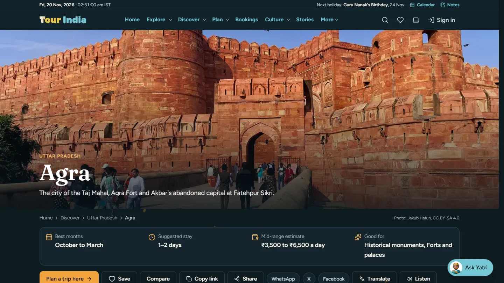
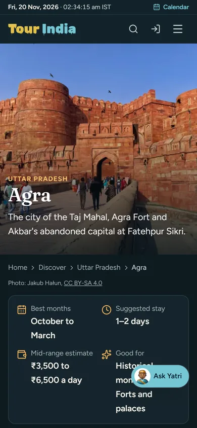
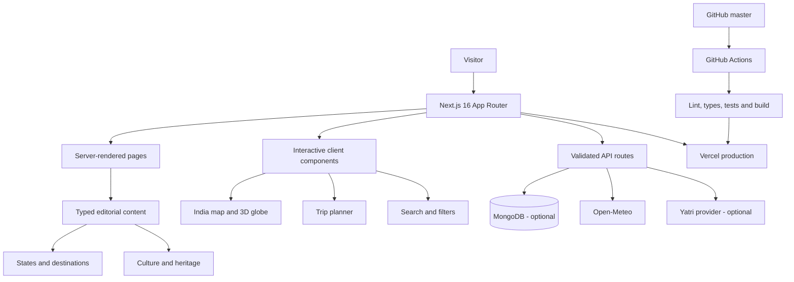

<!-- Tour India | India travel discovery and itinerary planning platform -->

<div align="center">

<a href="https://tour-india-pi.vercel.app">

</a>

# 🇮🇳 Tour India

### Discover India. Explore its culture. Plan your own journey.

**An independent travel discovery and planning platform for India's states, destinations, heritage and living culture.**

<p>
<a href="https://tour-india-pi.vercel.app"></a>
<a href="https://github.com/Supriyo016/TourIndia"></a>
<a href="https://github.com/Supriyo016/TourIndia/blob/master/docs/architecture.md"></a>
</p>

<p>
<a href="https://github.com/Supriyo016/TourIndia/actions/workflows/ci.yml"></a>
<a href="https://github.com/Supriyo016/TourIndia/actions/workflows/codeql.yml"></a>


<a href="LICENSE"></a>
</p>

<p>
<a href="https://www.instagram.com/supriyo016/"></a>
<a href="https://www.facebook.com/profile.php?id=100070487584093"></a>
<a href="https://x.com/Supriyo016"></a>
<a href="https://www.youtube.com/@supriyo016"></a>
<a href="https://github.com/Supriyo016"></a>
</p>

<sub>Created and maintained by <a href="https://github.com/Supriyo016"><strong>Supriyo Sarkar</strong></a> · Founder & Website Owner</sub>
<br>
<sub><em>Many cultures. Countless stories. One incredible India.</em></sub>

</div>

---

> [!IMPORTANT]
> **What Tour India is — and is not:** Tour India is an independent travel information and itinerary-planning platform, not a travel agency or booking operator. It does not sell tours, issue tickets, confirm hotel reservations, process payments, or guarantee third-party availability. Route distances, travel times and budget values in planner outputs are estimates. Always confirm current conditions, permits, fares, opening hours and safety information with the relevant official authority or service provider.

## 🧭 Quick navigation

| Section | Description |
|---|---|
| [About the platform](#-about-the-platform) | Purpose, scope and catalogue |
| [Visual showcase](#-visual-showcase) | Platform screenshots and responsive views |
| [Explore India](#-explore-india) | State map, destination globe and guides |
| [Culture and heritage](#-culture-food-and-heritage) | Festivals, cuisine, arts and heritage |
| [Trip planner](#-trip-planner) | Editable itinerary workflow |
| [Yatri assistant](#-yatri-travel-assistant) | Guide-grounded travel assistant |
| [Accounts and community](#-accounts-community-and-administration) | Personal travel and editorial features |
| [Technology and architecture](#-technology-stack) | Implementation, data and system design |
| [Run locally](#-run-locally) | Development setup |
| [Environment configuration](#-environment-configuration) | Optional integrations |
| [Testing and deployment](#-quality-assurance-and-deployment) | Automated checks and release flow |
| [Security and responsible travel](#-security-privacy-and-travel-information) | Privacy, safety and content standards |
| [Documentation](#-project-documentation) | Engineering references |
| [Connect](#-connect-with-the-project) | Social links and project owner |

---

## 🏞️ About the platform

**Tour India** brings destination discovery, cultural information and itinerary planning into one place. Visitors can explore an Indian state, browse destination guides, learn about local traditions, compare travel ideas and build a personal trip outline.

The current production application is maintained on **`master`** and deployed to Vercel. The `legacy/` directory preserves the original static website; it is not the application served by the current Next.js runtime. The historical `rebuild/nextjs` branch contains an earlier development snapshot and is not the current production source.

### Platform at a glance

<div align="center">
<table>
<tr>
<td align="center" width="25%"><h2>28 + 8</h2><strong>States & UTs</strong><br><sub>Regional profiles</sub></td>
<td align="center" width="25%"><h2>52</h2><strong>Destinations</strong><br><sub>Travel guides</sub></td>
<td align="center" width="25%"><h2>45</h2><strong>Heritage entries</strong><br><sub>UNESCO-listed properties</sub></td>
<td align="center" width="25%"><h2>24</h2><strong>Festivals</strong><br><sub>Calendar entries</sub></td>
</tr>
<tr>
<td align="center" colspan="2"><h2>29</h2><strong>Regional dishes</strong></td>
<td align="center" colspan="2"><h2>64</h2><strong>Traditional art forms</strong></td>
</tr>
</table>
<sub>Counts describe the current structured content catalogue. They are not a claim of exhaustive coverage of every place, festival or tradition in India.</sub>
</div>

## 🖼️ Visual showcase

<div align="center">

<a href="https://tour-india-pi.vercel.app">

</a>
<br>
<sub><strong>Home</strong> · A photo-led starting point for discovering India</sub>

<br><br>

<table>
<tr>
<td width="50%">

<p align="center"><sub><strong>Explore</strong> · 3D destination globe</sub></p>
</td>
<td width="50%">

<p align="center"><sub><strong>Destination</strong> · Guide and travel information</sub></p>
</td>
</tr>
<tr>
<td width="50%">

<p align="center"><sub><strong>Planner</strong> · Editable day-by-day itinerary</sub></p>
</td>
<td width="50%" align="center">

<p align="center"><sub><strong>Mobile</strong> · Responsive destination experience</sub></p>
</td>
</tr>
</table>

</div>

## ✨ Explore India

### 🗺️ Interactive state map

Explore all 28 states and 8 Union Territories through the interactive map.

- Select a region or state to open its profile.
- Discover regional destinations, food, festivals and cultural information.
- Move from a state overview into related destination guides.
- Explore the map's credits and data scope through the site's information pages.

### 🌐 Destination globe

The 3D globe provides a spatial way to explore the destination catalogue.

- Rotate and inspect the globe.
- Select destination markers to open their guides.
- Discover the geographical relationship between destinations.
- Move from globe discovery into the detailed destination pages.

### 📍 Destination guides

Destination pages connect editorial travel information with practical planning context:

- Destination overview, location and highlights.
- Attractions, experiences and nearby places.
- Recommended travel period and suggested stay.
- Ways to reach the destination and local transport notes.
- Accommodation areas, regional food and activities.
- Permit notes, accessibility information and practical precautions.
- Estimated budget ranges and useful external references.

### Travel catalogue

| Content collection | Current entries |
|---|---:|
| State and Union Territory profiles | **36** |
| Destination guides | **52** |
| UNESCO World Heritage entries | **45** |
| Festival entries | **24** |
| Regional dishes | **29** |
| Traditional art forms | **64** |
| Travel circuits | **6** |

## 🎭 Culture, food and heritage

Tour India treats culture as more than a list of tourist attractions. The catalogue includes living traditions, regional food and heritage references.

### Festival calendar

- Browse festival entries and date information.
- Filter the calendar and review source notes.
- Export supported calendar entries.
- Check the stated date and source because festival dates can vary by regional calendar and official announcement.

### Regional food

Explore regional dishes and food traditions across states and destination pages, with cultural context.

### Arts and traditions

Browse traditional art forms, crafts, dance and music, with regional context and supporting information.

### Heritage and museums

Explore heritage entries and museums, with references to source material. UNESCO status and inscription details should be interpreted in the context of the official World Heritage List.

## 🧳 Trip planner

The trip planner helps users build and edit a multi-stop outline using selected destinations and travel preferences.

- Set a starting point and choose destinations.
- Configure trip duration, travellers, budget, pace and interests.
- Review day-wise destination allocation and activity suggestions.
- Inspect approximate distances, travel legs, time and cost.
- Rearrange the itinerary and review warnings about overly rushed schedules.
- Use supported sharing and export options to retain or share a plan.

> [!NOTE]
> Planner calculations are estimates based on declared assumptions and available route information. They are not live ticket fares, confirmed transport schedules, accommodation quotes or booking confirmations. Validate every important leg independently before travelling.

## 🤖 Yatri — travel assistant

**Yatri** is the travel assistant integrated with Tour India's content and tools.

- Search the site's destination and state catalogue.
- Ask about destinations, festivals, regional food and practical travel topics.
- Discover relevant Tour India guides.
- Generate draft itinerary suggestions using the site's travel data.
- Use the built-in guide-answer path without an external AI provider.
- Optionally use a server-configured Groq or Vercel AI Gateway provider.

Yatri is not an official government source. It cannot guarantee current permits, closures, weather warnings, transport availability, personal safety or booking status. Verify consequential information directly with authoritative sources.

## 👤 Accounts, community and administration

When the required backend and authentication settings are configured, account and personal travel workflows include saved places, trips, notes, memories, collections, profile preferences, notifications, privacy controls and account deletion.

The repository also contains community and editorial workflows for stories, discussions, tips, questions, suggestions, moderation and review. Administrative features include role-based operations, support handling, content management, backups and audit-related workflows.

Backend-dependent workflows require their corresponding services and secrets to be configured. The public guide and destination content remain available without a database.

## 📱 Responsive and accessible experience

- Layouts for desktop, tablet and mobile screens.
- Theme-aware interface with light and dark appearance.
- Photo-led destination cards and interactive map/globe views.
- Keyboard-accessible controls where implemented.
- Reduced-motion considerations in interface components.
- Playwright end-to-end tests with axe accessibility checks.

The README images show selected product views; they are not a guarantee that every interaction has been independently accessibility-certified.

## 🧰 Technology stack

<div align="center">

</div>

| Layer | Main technology |
|---|---|
| Framework | Next.js 16 App Router |
| UI | React 19 |
| Language | TypeScript strict mode |
| Styling | Tailwind CSS 4 |
| Data | Typed editorial modules · MongoDB driver / Atlas when configured |
| Validation | Zod |
| Forms | React Hook Form |
| Maps and geography | SVG India map · 3D globe · Google Maps integrations |
| Interactions | dnd kit |
| Weather | Open-Meteo |
| Assistant | Guide-grounded Yatri · Groq / Vercel AI Gateway optional |
| Testing | Vitest · Playwright · axe |
| Code quality | ESLint · TypeScript · npm audit |
| Security analysis | CodeQL |
| Hosting | Vercel |
| Automation | GitHub Actions |

## 🏗️ Architecture

The application uses the Next.js App Router. Most editorial pages are rendered on the server from typed content modules. Interactive client components are used where needed for search, maps, the planner, filters and forms. Server API routes validate submissions before using external services or persistent storage.



### Engineering principles

- Typed editorial content as the foundation for destination and cultural pages.
- Server-rendered public guides with small interactive client components.
- Optional MongoDB persistence for forms and account-dependent workflows.
- Server-side validation, origin checks, request limits and rate limiting for API submissions.
- Clear separation between public editorial content and private account data.
- Source attribution and fact-check notes for travel information.

### Repository structure

```text
TourIndia/
│
├── .github/
│   └── workflows/          # CI and security workflow
│
├── docs/                   # Architecture, setup, operations and project notes
│
├── legacy/                 # Original static website (preserved)
│
├── public/                 # Static assets and public images
│
├── scripts/                # Map, image and database setup scripts
│
├── src/
│   ├── app/                 # Next.js routes and API endpoints
│   ├── components/          # Shared UI and feature components
│   ├── config/              # Brand, social, owner and navigation settings
│   ├── data/                # Typed travel and culture catalogue
│   ├── features/            # Planner, search, assistant and business logic
│   ├── lib/                 # Database, validation and security utilities
│   └── types/               # Shared TypeScript types
│
├── tests/                   # Unit, security and end-to-end tests
├── .env.example
├── package.json
├── next.config.ts
└── README.md
```

## 🚀 Run locally

### Requirements

- Node.js **20.9 or later**
- npm
- Git

### Setup

Clone the repository:

```bash
git clone https://github.com/Supriyo016/TourIndia.git
cd TourIndia
```

Install dependencies:

```bash
npm install
```

Start the development server:

```bash
npm run dev
```

Open [http://localhost:3000](http://localhost:3000).

The public guide works without MongoDB or AI credentials. Forms and account-dependent capabilities remain unavailable until their required services are configured.

## 🔧 Environment configuration

Copy the example file:

```bash
cp .env.example .env.local
```

Configure only the services you intend to use.

| Variable | Purpose | Required |
|---|---|---|
| `NEXT_PUBLIC_SITE_URL` | Canonical site URL and origin validation | Recommended |
| `MONGODB_URI` | MongoDB connection string | Optional for public guide; required for persisted data |
| `MONGODB_DB` | Database name (default: `tour_india`) | When MongoDB is enabled |
| `RATE_LIMIT_SALT` | Secret for privacy-aware rate-limit hashing | Required for production form submissions |
| `GROQ_API_KEY` | Optional Yatri AI provider | Optional |
| `AI_GATEWAY_API_KEY` | Optional Vercel AI Gateway key | Optional |
| `AI_GATEWAY_OIDC` | Use deployment OIDC for AI Gateway where configured | Optional |
| `AUTH_SECRET` | Signs authentication codes and state | Required for production sign-in |
| `RESEND_API_KEY` | Sends email sign-in codes | Required for email sign-in |
| `EMAIL_FROM` | Verified sender address | Required for email sending |
| `AUTH_GOOGLE_ID` / `AUTH_GOOGLE_SECRET` | Google OAuth sign-in | Optional |
| `ADMIN_EMAILS` | Admin account allow-list | For admin access |
| `NEXT_PUBLIC_GOOGLE_MAPS_API_KEY` | Maps integrations | Optional |
| `NEXT_PUBLIC_GOOGLE_MAP_ID` | Google vector map styling / features | Optional |
| `GOOGLE_SITE_VERIFICATION` | Search Console verification | Optional |

See [`.env.example`](.env.example) for the full list and comments. Never commit real secrets, tokens or database credentials.

## 🧪 Quality assurance and deployment

### Local checks

Run the project's available quality checks:

```bash
npm run lint
npm run typecheck
npm test
npm run build
npm run test:e2e
```

| Command | Purpose |
|---|---|
| `npm run lint` | ESLint checks |
| `npm run typecheck` | Next.js type generation and TypeScript checks |
| `npm test` | Unit and API tests with Vitest |
| `npm run build` | Production build |
| `npm run test:e2e` | Browser tests with Playwright and axe |

### Continuous integration

The current CI workflow in `.github/workflows/ci.yml` installs dependencies, runs a production dependency audit, type checks, linting, unit tests, the production build and Playwright end-to-end tests. The workflow provisions MongoDB for integration tests.

CodeQL analysis is configured separately through `.github/workflows/codeql.yml`.

<div align="center">
<a href="https://github.com/Supriyo016/TourIndia/actions">

</a>
<a href="https://github.com/Supriyo016/TourIndia/security/code-scanning">

</a>
</div>

### Deployment

The production application is deployed on Vercel from **`master`**. Pull requests can use preview deployments depending on the Vercel project configuration. Database setup, environment variables, release and rollback details are covered in [docs/setup.md](docs/setup.md) and [docs/OPERATIONS.md](docs/OPERATIONS.md).

## 🔐 Security, privacy and travel information

- Keep all secrets in local environment files or deployment secret settings, never in source control.
- API submissions are subject to origin checks, content-type and payload-size checks, validation and rate limiting.
- Database credentials should use least-privilege access.
- Private vulnerability reports should follow [SECURITY.md](SECURITY.md).
- Travel information can change. Verify permits, closures, transport, safety notices and operating hours with official sources.
- Planner estimates are planning aids, not guaranteed prices or schedules.
- Photographs and map data have their own licences and credits; the MIT licence applies to source code only.

## 📚 Project documentation

| Document | What it covers |
|---|---|
| [Project status](docs/PROJECT_STATUS.md) | Current progress, configuration needs and project notes |
| [Architecture](docs/architecture.md) | Application layout, rendering and data flow |
| [Setup and deployment](docs/setup.md) | Local setup, Vercel and environment configuration |
| [API reference](docs/api.md) | Routes, request validation and responses |
| [Security audit](docs/SECURITY_AUDIT.md) | Security controls, tests and identified risks |
| [Operations](docs/OPERATIONS.md) | Production operation and troubleshooting |
| [Backups](docs/BACKUPS.md) | Backup and restore process |
| [Fact-check log](docs/FACT_CHECK.md) | Sources and editorial verification notes |
| [Contributing](CONTRIBUTING.md) | Contribution rules and development workflow |
| [Security policy](SECURITY.md) | Private vulnerability reporting |
| [Licence](LICENSE) | MIT licence for source code |

## 🤝 Contributing

Corrections and focused improvements are welcome, especially well-sourced travel information and bug fixes.

1. Read [CONTRIBUTING.md](CONTRIBUTING.md).
2. Check the existing issues before starting larger changes.
3. Include sources for factual travel corrections.
4. Keep changes focused and describe how you tested them.
5. Ensure the CI checks pass before requesting review.

Do not add invented prices, availability, visitor counts, reviews or booking claims. Photographs must have a licence that allows reuse and must be credited appropriately.

## 🌏 Project ecosystem

The Tour India platform is part of a connected portfolio of research, software engineering and practical technology projects. Explore the other projects below.

<div align="center">

<table>
<tr>
<td align="center" width="50%">
<a href="https://developerbro.vercel.app">

</a>
<br><br>
<strong>Research · Engineering · Ideas</strong>
<br>
<sub>A research-focused academic portfolio featuring project case studies, technical writing, research interests and software development work.</sub>
<br><br>
<a href="https://developerbro.vercel.app">Live Portfolio</a> ·
<a href="https://github.com/Supriyo016/DeveloperBro-Academic-Portfolio">Source Code</a>
</td>
<td align="center" width="50%">
<a href="https://github.com/Supriyo016/Arduino-Uno-Third-Hand-Eye-Project-for-Visually-Impaired-Individuals">

</a>
<br><br>
<strong>Sense · Measure · Alert</strong>
<br>
<sub>An Arduino Uno and HC-SR04 based ultrasonic obstacle-alert prototype with an audible buzzer, embedded firmware, circuit documentation and C++ tests.</sub>
<br><br>
<a href="https://github.com/Supriyo016/Arduino-Uno-Third-Hand-Eye-Project-for-Visually-Impaired-Individuals">Source Code</a> ·
<a href="https://www.youtube.com/watch?v=xSJj8tTnAgg">Project Demo</a>
</td>
</tr>
</table>

<br>

<a href="https://github.com/Supriyo016">

</a>

<br><br>

<sub><em>From digital experiences to embedded prototypes — building useful ideas through technology.</em></sub>

</div>

## 📬 Connect with the project

<div align="center">

<a href="https://github.com/Supriyo016"></a>
<a href="https://x.com/Supriyo016"></a>
<a href="https://www.instagram.com/supriyo016/"></a>
<a href="https://www.facebook.com/profile.php?id=100070487584093"></a>
<a href="https://www.youtube.com/@supriyo016"></a>

<br><br>

**Tour India** · Founded and maintained by **Supriyo Sarkar**

<sub>Independent travel discovery · Cultural exploration · Thoughtful itinerary planning</sub>

<br>

<em>“Many cultures. Countless stories. One incredible India.”</em>

<br><br>

<a href="https://tour-india-pi.vercel.app"></a>
<a href="https://github.com/Supriyo016/TourIndia"></a>

</div>

---

<div align="center">

<sub>Built with curiosity, cultural respect and a love for exploring India.</sub>

<br><br>


</div>
