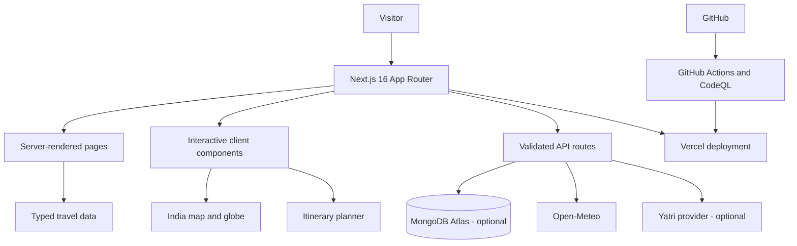

<!-- Tour India | Current application documentation -->

<div align="center">

<a href="https://tour-india-pi.vercel.app"></a>

# 🇮🇳 Tour India

### Discover India. Explore its culture. Plan your own journey.

**An independent travel discovery and planning platform covering 28 states and 8 Union Territories.**

<a href="https://tour-india-pi.vercel.app"></a>
<a href="https://github.com/Supriyo016/TourIndia/tree/rebuild/nextjs"></a>

<p>
<a href="https://github.com/Supriyo016/TourIndia/actions/workflows/ci.yml"></a>
<a href="https://github.com/Supriyo016/TourIndia/actions/workflows/codeql.yml"></a>


</p>

<sub>Created and maintained by <a href="https://github.com/Supriyo016">Supriyo Sarkar</a> · Founder & Website Owner</sub>
</div>

---

> [!IMPORTANT]
> Tour India is an **independent travel information and planning platform**, not a travel agency. It does not sell tours, issue tickets, confirm hotel reservations, process payments or guarantee third-party availability. Planner travel times and costs are estimates, not live fares or quotations.

## 🏞️ A window into India

Tour India connects destination discovery, culture, practical information and itinerary planning. Explore a state, browse destination guides, understand local traditions, compare places and organise your own travel outline.

<div align="center">
<a href="https://tour-india-pi.vercel.app"></a>
<sub>Homepage · Destination-led discovery</sub>
</div>

## 📍 Travel catalogue

| Editorial catalogue | Current entries |
|---|---:|
| State and Union Territory profiles | **36** |
| Destination guides | **52** |
| UNESCO World Heritage entries | **45** |
| Festival entries | **24** |
| Regional dishes | **29** |
| Traditional art forms | **64** |
| Travel circuits | **6** |

These figures refer to the current site's structured content records; they are not a claim of exhaustive coverage of all Indian places or traditions.

## ✨ Explore the platform

### 🗺️ Interactive India map

- Explore all 28 states and 8 Union Territories.
- Hover or focus on a state for a short preview, then open its full profile.
- Browse state-level culture, food, festivals, languages and related destination guides.
- Follow map credits and limitations from the map page.

### 🌐 3D destination globe

- Rotate the globe to explore destination locations.
- Select a destination marker to open its guide.
- Move from globe discovery into the detailed destination catalogue.

<div align="center">

<br><sub>Explore · Destination globe</sub>
</div>

### 🧭 Detailed destination guides

Guides bring together seasonal advice, recommended length of stay, attractions, ways to reach the destination, accommodation areas, food, nearby places, cost ranges, permit notes, accessibility and practical precautions.

<div align="center">

<br><sub>Destination guide · Example: Agra</sub>
</div>

### 🧳 Editable trip planner

Build a multi-stop outline from a starting city and selected destinations.

- Choose trip duration, travellers, budget, pace and interests.
- Select transport preferences or use mixed transport planning.
- Review day-wise activity suggestions and destination allocation.
- See estimated travel legs, distance, duration and cost.
- Rearrange the plan and review warnings about rushed schedules.
- Share the plan and reopen it from a supported share link.

<div align="center">

<br><sub>Planner · Editable day-by-day itinerary</sub>
</div>

> **Planning transparency:** costs, travel times and distances are generated using assumptions and approximate route calculations. Confirm fares, live conditions, transport services and booking availability with the relevant provider.

### 🎭 Culture, food and heritage

- Festival and public holiday calendar with date notes and calendar export.
- Regional cuisine and traditional dishes.
- Arts, crafts, dance, music and cultural traditions.
- UNESCO heritage information and museums.
- Culture by region and destination.
- Travel stories, practical explainers and community contributions.

### 🤖 Yatri — travel assistant

Yatri helps users search the site's travel catalogue, ask about a state or destination, find festivals and dishes, explore practical travel information and create a draft itinerary.

- Answers are grounded in Tour India's own content and tools.
- Works in guide-answer mode without an external AI provider.
- Can use Groq or Vercel AI Gateway when configured server-side.
- Provides links to relevant Tour India pages.
- Uses constrained tools and bounded response handling.

Yatri is not an official government source and cannot verify real-time permits, closures, safety conditions, transport availability or bookings.

### 👤 Accounts and personal travel space

When the database and authentication services are configured, users can access account and personal-data features such as saved places, trips, notes, memories, collections, notifications, privacy controls and account deletion.

### 🧑‍🤝‍🧑 Community and editorial tools

The codebase includes moderated stories, discussions, tips, questions, suggestions and an editorial review flow. Public contribution/persistence features depend on the configured backend.

### 🛡️ Administration and operations

Protected admin tools support content management, moderation, support, roles and permissions, audit logs, health monitoring, SEO, backups, feature controls and scheduled content publishing.

## 📱 Responsive interface

The interface is designed for desktop and mobile browsing, with photo-led destination cards and a travel-focused visual system.

<div align="center">

<br><sub>Mobile destination view</sub>
</div>

## 🧰 Technology stack

<div align="center">

</div>

| Layer | Main technology |
|---|---|
| Framework | Next.js 16 App Router |
| UI | React 19 |
| Language | TypeScript strict mode |
| Styling | Tailwind CSS 4 |
| Data | Typed content modules · MongoDB driver / Atlas when configured |
| Validation | Zod |
| Forms | React Hook Form |
| Maps and geography | SVG India map · 3D globe · Google Maps integrations |
| Interactions | dnd kit |
| Weather | Open-Meteo |
| Assistant | Yatri · Groq or Vercel AI Gateway (optional) |
| Testing | Vitest · Playwright · axe |
| Code checks | ESLint · TypeScript · npm audit |
| Security analysis | CodeQL |
| Dependency updates | Dependabot |
| Hosting | Vercel |
| Automation | GitHub Actions |

## 🏗️ Architecture

Next.js App Router serves pages from typed editorial content. Interactive client components are used where required, such as the map, planner, search and forms. Server API routes validate inputs before accessing external services or persistent storage.



### Engineering principles

- Content-first architecture with typed records for states, destinations and cultural material.
- Server Components by default, with small interactive client components.
- MongoDB is optional for reading the public guide; it is required for persistent account and submission workflows.
- API boundaries apply origin, content-type, body-size, rate-limit and schema checks.
- Secrets stay in server-side environment variables.
- Fallbacks keep the core guide useful when optional integrations are not available.

See [Architecture](docs/architecture.md) for implementation details.

## 📂 Repository structure

```text
TourIndia/
├── .github/
│   ├── ISSUE_TEMPLATE/
│   └── workflows/           # CI and CodeQL
├── docs/
│   ├── assets/              # Banner and README screenshots
│   ├── research/
│   ├── architecture.md
│   ├── setup.md
│   ├── api.md
│   ├── PROJECT_STATUS.md
│   ├── OPERATIONS.md
│   ├── SECURITY_AUDIT.md
│   └── FACT_CHECK.md
├── legacy/                  # Original static website
├── public/images/           # Destination, state and culture media
├── scripts/                 # Map, image and database utilities
├── src/
│   ├── app/                 # Public, account and admin routes
│   ├── components/          # UI and feature components
│   ├── config/              # Site and brand configuration
│   ├── data/                # Typed travel content
│   ├── features/            # Planner, assistant, accounts, community
│   ├── hooks/
│   ├── lib/                 # Database, security and helpers
│   └── types/
├── tests/
│   ├── e2e/
│   ├── security/
│   └── unit/
├── .env.example
└── package.json
```

Generated map and image manifests under `src/data/generated/` are built by scripts; update their source data instead of editing generated output manually.

## 🚀 Run locally

### Requirements

- Node.js 20.9 or later
- npm
- Git

### Clone the current application branch

The current Next.js application is maintained on **`rebuild/nextjs`**. The `master` branch currently represents the legacy/original website.

```bash
git clone --branch rebuild/nextjs https://github.com/Supriyo016/TourIndia.git
cd TourIndia
npm install
cp .env.example .env.local
npm run dev
```

On Windows PowerShell, create the local environment file with:

```powershell
Copy-Item .env.example .env.local
```

Open [http://localhost:3000](http://localhost:3000).

Core guide pages do not need a database. Features that save user records, send emails or use external providers require their corresponding configuration.

## 🔧 Environment variables and optional integrations

The full commented template is [`.env.example`](.env.example). Never commit secrets or real credentials.

| Variable | What it configures |
|---|---|
| `NEXT_PUBLIC_SITE_URL` | Canonical site address |
| `MONGODB_URI`, `MONGODB_DB` | MongoDB persistence |
| `RATE_LIMIT_SALT` | Hashed rate-limit identifiers |
| `GROQ_API_KEY` | Yatri via Groq |
| `AI_GATEWAY_API_KEY` / `AI_GATEWAY_OIDC` | Yatri via Vercel AI Gateway |
| `ASSISTANT_MODELS` / `ASSISTANT_DAILY_LIMIT` | Optional Yatri model and usage settings |
| `AUTH_SECRET` | Account authentication |
| `RESEND_API_KEY`, `EMAIL_FROM` | Email verification codes |
| `AUTH_GOOGLE_ID`, `AUTH_GOOGLE_SECRET` | Google OAuth |
| `ADMIN_EMAILS` | Admin sign-in allowlist |
| `NEXT_PUBLIC_GOOGLE_MAPS_API_KEY`, `NEXT_PUBLIC_GOOGLE_MAP_ID` | Google Maps features |
| `GOOGLE_SITE_VERIFICATION` | Search Console verification |
| `COOKIE_SECRET` | Explicit cookie signing secret |
| `TRUSTED_PROXY_HOPS` | Trusted reverse proxy configuration for self-hosting |

### Service availability

| Feature | Without credentials | With configuration |
|---|---|---|
| State and destination guides | Available | Available |
| Search, catalogue and planner | Available | Available |
| Yatri | Guide-grounded answers | AI provider can be used |
| Persistent accounts and saved data | Unavailable | MongoDB + auth configuration |
| Email sign-in | Unavailable | Auth secret + Resend |
| Google sign-in | Unavailable | Google OAuth credentials |
| Database-backed forms/community | Report unavailable | MongoDB configured |
| Google Maps enhancements | Supported fallback views | Configured Google Maps features |

Detailed instructions for MongoDB, Yatri, OAuth, email, Maps and Vercel are in [docs/setup.md](docs/setup.md).

## 🧪 Quality assurance

Run the following before opening a pull request:

```bash
npm run typecheck
npm run lint
npm test
npm run build
npx playwright install --with-deps chrome
npm run test:e2e
```

| Command | Purpose |
|---|---|
| `npm run dev` | Start development server |
| `npm run build` | Build production application |
| `npm run vercel-build` | Run deployment DB setup and Next.js build |
| `npm run start` | Serve production build |
| `npm run typecheck` | Generate Next.js types and check TypeScript |
| `npm run lint` | Run ESLint |
| `npm test` | Run Vitest tests |
| `npm run test:e2e` | Run Playwright tests |
| `npm run db:setup` | Create/update database structures |
| `npm run data:map` | Rebuild generated map data |
| `npm run data:images` | Rebuild image manifest |

### GitHub Actions

The CI workflow installs dependencies, audits production dependencies, runs type checking, lint, Vitest, production build and Playwright browser tests against a MongoDB service. CodeQL analyses the TypeScript/JavaScript code. Dependabot monitors dependencies.

## ☁️ Deployment

The current Next.js application is configured for Vercel. The deployment build runs `npm run vercel-build`.

**Branch warning:** verify the Vercel production branch before changing deployment settings. The newer application lives on `rebuild/nextjs`; `master` is the legacy branch in the current repository history. Deploying the wrong branch may publish the old site.

Read:
- [Setup and deployment](docs/setup.md)
- [Operations guide](docs/OPERATIONS.md)
- [Project status and owner actions](docs/PROJECT_STATUS.md)

## 🔐 Security, privacy and responsible travel

Security features include server-side validation, same-origin checks, payload limits, rate limits, signed sessions, role-based admin access, protected secrets and security-focused tests. These controls reduce risk; they do not make any application completely secure.

For controls and known risks see [Security Audit](docs/SECURITY_AUDIT.md), [Operations](docs/OPERATIONS.md) and [Backups](docs/BACKUPS.md).

**Travel facts change.** Confirm permits, opening periods, road and weather conditions, safety guidance, religious-site rules, fares and availability with the appropriate official authority or service provider. The site's India map is for navigation and is not an authoritative statement of international boundaries.

The source and review status of travel claims is recorded in [Fact Checking](docs/FACT_CHECK.md).

## 📚 Documentation

| Guide | What it explains |
|---|---|
| [Project status](docs/PROJECT_STATUS.md) | Current state, tested items and owner actions |
| [Setup](docs/setup.md) | Environment, integrations, Vercel and rollback |
| [Architecture](docs/architecture.md) | Code structure and data flow |
| [API reference](docs/api.md) | Routes and data contracts |
| [Operations](docs/OPERATIONS.md) | Running and maintaining the platform |
| [Backups](docs/BACKUPS.md) | Backup and recovery |
| [Security audit](docs/SECURITY_AUDIT.md) | Security controls and residual risks |
| [Fact checking](docs/FACT_CHECK.md) | Travel content sourcing and verification |
| [Decisions](docs/DECISIONS.md) | Engineering/product decisions |
| [Contributing](CONTRIBUTING.md) | Issues and pull requests |

## 🤝 Contributing

Corrections, source links, accessibility fixes and reproducible bug reports are welcome.

1. Read [CONTRIBUTING.md](CONTRIBUTING.md).
2. Use the GitHub issue templates.
3. Make changes on a focused branch from `rebuild/nextjs`.
4. Cite sources for factual travel-content changes.
5. Run lint, typecheck, tests and build.
6. Describe the change and verification in the pull request.

Do not invent prices, schedules, permit requirements, visitor counts, safety assurances or booking availability. Reused photographs and other media must have appropriate licences and credits.

Report security concerns privately as described in [SECURITY.md](SECURITY.md).


## 🧩 More projects by the developer

Tour India is part of a wider portfolio of research and engineering projects:

| Project | Focus | Explore |
|---|---|---|
| **DeveloperBro. Academic Portfolio** | Research case studies, academic profile and technical writing | [Live portfolio](https://developerbro.vercel.app) · [GitHub repository](https://github.com/Supriyo016/DeveloperBro-Academic-Portfolio) |
| **Third Hand-Eye** | Arduino Uno, ultrasonic sensing and an audible obstacle-alert prototype | [GitHub repository](https://github.com/Supriyo016/Arduino-Uno-Third-Hand-Eye-Project-for-Visually-Impaired-Individuals) |

<div align="center">
<a href="https://developerbro.vercel.app"></a>
<a href="https://github.com/Supriyo016/Arduino-Uno-Third-Hand-Eye-Project-for-Visually-Impaired-Individuals"></a>
</div>

## 📜 Licence and attribution

The application code is released under the [MIT Licence](LICENSE). This licence does **not** automatically cover every photograph, video, map dataset or third-party asset.

- Photo attributions are available on the relevant pages and [/credits](https://tour-india-pi.vercel.app/credits).
- Weather information is provided by [Open-Meteo](https://open-meteo.com/).
- Map/geographic data carries separate provider and licence conditions; review the credits and project status notes.
- The original static project is retained in [`legacy/`](legacy/).

## 🧑‍💻 Project owner

<div align="center">
<a href="https://github.com/Supriyo016"></a>
<br>
<a href="https://x.com/Supriyo016"></a>
<a href="https://www.instagram.com/supriyo016/"></a>
<a href="https://www.youtube.com/@supriyo016"></a>
<a href="https://www.facebook.com/profile.php?id=100070487584093"></a>
<br><br>
<strong>Explore more. Travel thoughtfully. Respect every place and community.</strong>
<br>
<a href="https://tour-india-pi.vercel.app">Visit Tour India ↗</a>
<br><br>

</div>
