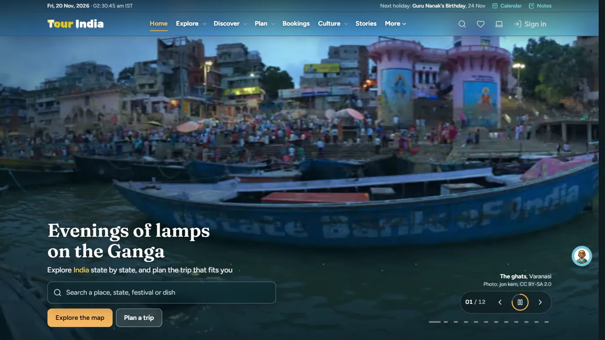
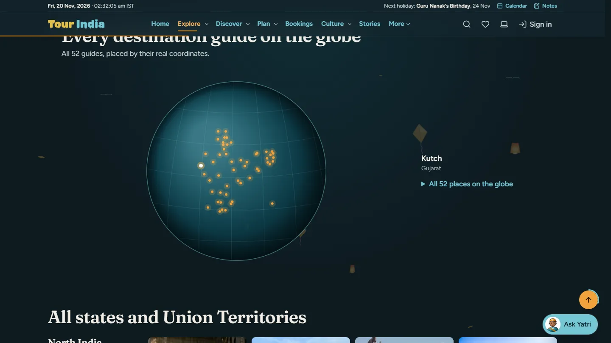
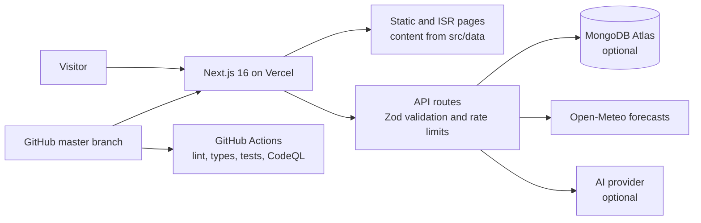

<div align="center">

<a href="https://tour-india-pi.vercel.app"></a>

**An independent guide to discovering and planning travel across all 28 states and 8 Union Territories of India.**

[**Visit the live site**](https://tour-india-pi.vercel.app) · [Architecture](docs/architecture.md) · [API](docs/api.md) · [Contributing](CONTRIBUTING.md)

[](https://github.com/Supriyo016/TourIndia/actions/workflows/ci.yml)
[](https://github.com/Supriyo016/TourIndia/actions/workflows/codeql.yml)


[](LICENSE)

</div>

> [!NOTE]
> Tour India is a travel guide, not a travel agency. It does not sell tours, take bookings or process payments.

<br>



## Contents

- [Highlights](#highlights)
- [Screenshots](#screenshots)
- [Features](#features)
- [Tech stack](#tech-stack)
- [Architecture](#architecture)
- [Getting started](#getting-started)
- [Testing](#testing)
- [Deployment](#deployment)
- [Documentation](#documentation)
- [Contributing](#contributing)
- [Licence and credits](#licence-and-credits)

## Highlights

| | |
|---|---|
| **36** | state and Union Territory profiles on an interactive map |
| **52** | destination guides, also shown on a 3D globe at their real coordinates |
| **45** | UNESCO World Heritage Sites, plus 20 museums and sites |
| **24** | festivals in a calendar you can export to your own calendar app |
| **29** | regional dishes and **64** traditional art forms |
| **6** | ready-made travel circuits, and a day-by-day trip planner |

## Screenshots

<table>
  <tr>
    <td width="50%"><br><sub><b>Explore:</b> a 3D globe of every destination guide</sub></td>
    <td width="50%"><br><sub><b>Destination guide:</b> best months, stay length and cost range</sub></td>
  </tr>
  <tr>
    <td width="50%"><br><sub><b>Trip planner:</b> builds an editable day-by-day itinerary</sub></td>
    <td width="50%" align="center"><br><sub><b>On a phone:</b> every page is responsive</sub></td>
  </tr>
</table>

## Features

**Discover**
- Interactive map of India: point to a state for a summary, select it for its full profile
- 3D globe of all destination guides, with drag to turn and click to open
- Search with suggestions across places, states, festivals and dishes
- Side-by-side comparison of destinations

**Plan**
- Trip planner that orders destinations, fills each day and shows estimates; drag and drop to rearrange
- Season and weather hints (Open-Meteo), packing list, print, and share links
- Travel quiz that suggests where to go

**Culture**
- Festival and public holiday calendar with calendar export
- Regional food, UNESCO heritage sites, museums and an arts encyclopedia
- Travel stories, and community contributions with moderation

**Yatri, the travel assistant**
- Answers from the site's own guides and links to the relevant pages
- Uses an AI provider when one is configured (Groq or Vercel AI Gateway); otherwise it answers from the guides directly

**Accounts** (when a database is connected)
- Saved places, trips, memories, notes and collections
- Notifications, privacy controls and account deletion

**Administration**
- Moderation, support tickets, content editing, cookieless analytics, SEO centre, backups, roles and two-factor sign-in

**Reliability**
- Animated error screens for 404, 500, 502, 503, 504, 401, 403 and offline, each with recovery actions
- Every public page works without a database

## Tech stack

| Layer | Technology |
|---|---|
| Framework | Next.js 16 (App Router), React 19 |
| Language | TypeScript (strict) |
| Styling | Tailwind CSS 4 |
| Data | MongoDB Atlas (optional), content as typed modules in `src/data` |
| Validation and forms | Zod, React Hook Form |
| Maps and interaction | Inline SVG map of India, canvas globe, Google Maps embeds, dnd kit |
| Testing | Vitest (unit and API), Playwright with axe (end to end and accessibility) |
| Hosting and CI | Vercel, GitHub Actions, CodeQL, Dependabot |

## Architecture



Pages are rendered on the server and cached, so the site is fast and works without a database. Only accounts, forms and community features need MongoDB. More detail is in [docs/architecture.md](docs/architecture.md).

## Getting started

You need Node.js 20.9 or later.

```bash
git clone https://github.com/Supriyo016/TourIndia.git
cd TourIndia
npm install
npm run dev
```

Open http://localhost:3000. The site runs without any configuration.

To turn on accounts and forms, copy `.env.example` to `.env.local` and fill in the values. Each variable is explained in [docs/setup.md](docs/setup.md).

## Testing

```bash
npm run lint        # ESLint
npm run typecheck   # TypeScript
npm test            # unit and API tests (Vitest)
npm run test:e2e    # end-to-end and accessibility tests (Playwright)
```

Every pull request runs all of these in GitHub Actions, along with a CodeQL security scan.

## Deployment

Vercel deploys the `master` branch to production, and every pull request gets a preview deployment. Environment variables, MongoDB setup and rollback steps are in [docs/setup.md](docs/setup.md).

## Documentation

| Document | Contents |
|---|---|
| [Project status](docs/PROJECT_STATUS.md) | Where things stand, and what needs the owner |
| [Setup and deployment](docs/setup.md) | Environment, Vercel, MongoDB, rollback |
| [Architecture](docs/architecture.md) | Structure, and how to add content |
| [API](docs/api.md) | Routes and collections |
| [Security audit](docs/SECURITY_AUDIT.md) | Protections, tests and remaining risks |
| [Operations](docs/OPERATIONS.md) and [Backups](docs/BACKUPS.md) | Running the site day to day |
| [Fact checking](docs/FACT_CHECK.md) | How travel information is sourced |
| [Decisions](docs/DECISIONS.md) | What was chosen and why |

## Contributing

Corrections and improvements are welcome. Please read [CONTRIBUTING.md](CONTRIBUTING.md) first, and use the issue templates for bugs and content corrections. Report security issues privately as described in [SECURITY.md](SECURITY.md).

## Licence and credits

The code is released under the [MIT licence](LICENSE). Photographs, videos and map data keep their own licences.

- Photographs from Wikimedia Commons, credited on each page and listed at [/credits](https://tour-india-pi.vercel.app/credits)
- Destination maps by Google Maps; state boundaries credited at [/credits#map-data](https://tour-india-pi.vercel.app/credits#map-data)
- Weather forecasts from Open-Meteo

The project started at Smart India Hackathon 2022. The original static site is preserved in [`legacy/`](legacy/).

<div align="center">
<sub>Built and maintained by <a href="https://github.com/Supriyo016">Supriyo Sarkar</a>, founder and owner of Tour India.</sub>
</div>
